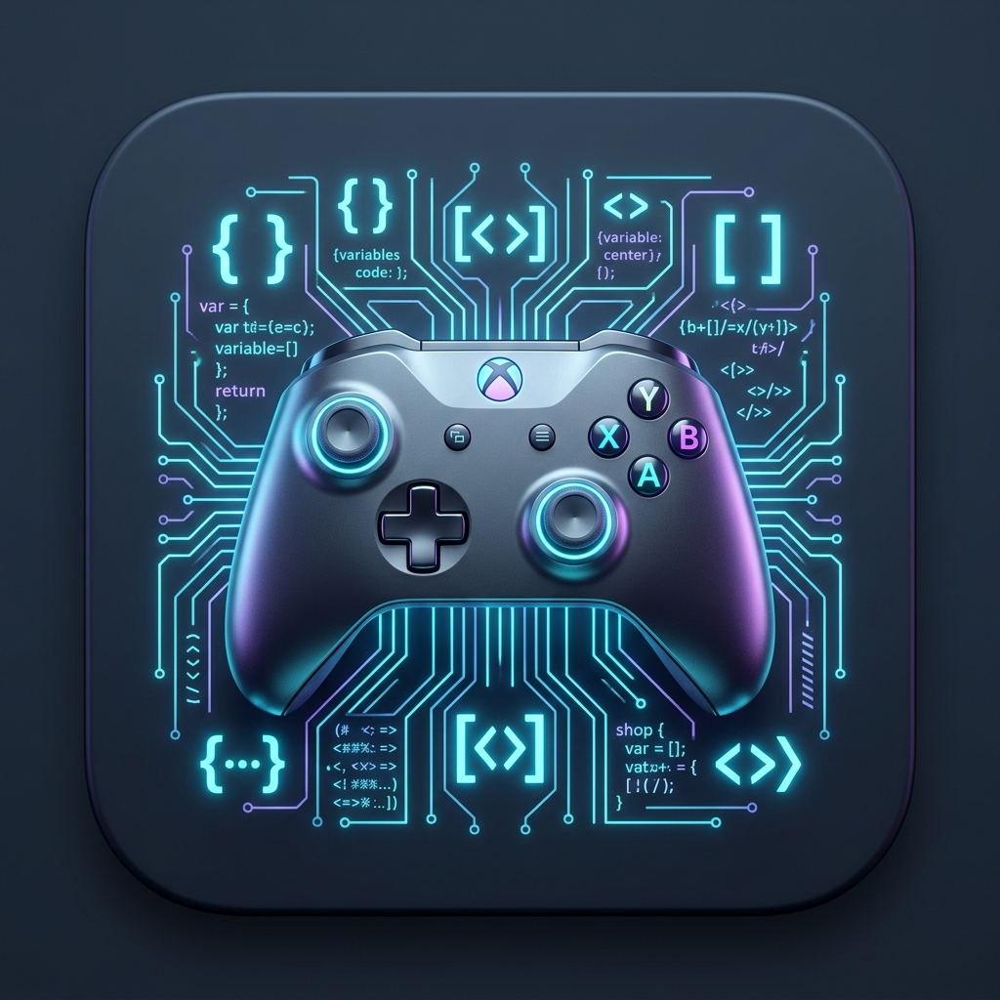

# Modding Support Tool (Assembly C# Dumper)

<p align="center">
  
</p>

<p align="center">
  <strong>MelonLoader에 주입할 모드 DLL을 만들 때, AI 에이전트(와 사람)가 참고할 C# 레퍼런스를 만들어 주는 도구</strong><br/>
  Unity(Mono/Il2Cpp) 게임 어셈블리를 자동 판별해 C# 소스·시그니처 스켈레톤으로 덤프하고, MCP 서버와 에이전트 스킬로 Claude Code · Antigravity · Gemini CLI에 연결합니다.
</p>

<p align="center">
  <a href="https://dotnet.microsoft.com/"></a>
  <a href="https://avaloniaui.net/"></a>
  
  
</p>

---

## 🎯 이 도구의 범위 (먼저 읽어 주세요)

| ✅ 하는 일 | ❌ 하지 않는 일 → 쓸 도구 |
| :--- | :--- |
| **MelonLoader로 주입할 모드 DLL**을 만들 때 참고할 C# 레퍼런스 생성 | Unreal Engine(UE4/UE5) 게임 모딩·SDK 덤프 → **UE4SS** |
| Unity **Mono** 게임: ilspycmd 전체 디컴파일 + 본문을 뺀 AI 아웃라인 | Il2Cpp 메서드 본문(네이티브 로직) 분석 → Cpp2IL, Il2CppDumper + Ghidra/IDA |
| Unity **Il2Cpp** 게임: MelonLoader `Il2CppAssemblies`의 시그니처 스켈레톤 | 네이티브 C/C++ 바이너리 리버싱 → Ghidra, IDA, x64dbg |
| 레퍼런스 검색·선언 조회·Harmony 패치·모드 프로젝트(.csproj) 생성 | 메모리 값 탐색 → Cheat Engine / 에셋 추출 → AssetRipper, UABEA |

게임 파일을 고치는 도구가 아니라, 에이전트가 **"어떤 클래스의 어떤 메서드를 어떤 시그니처로 패치할지" 추측하지 않고 확인**하게 해 주는 도구입니다.

---

## 🤖 AI 에이전트 연동 (MCP + 스킬)

명령 한 번으로 스킬 문서(MD)를 각 에이전트의 스킬 폴더에 설치하고, 이 exe를 MCP 서버로 등록합니다.

```powershell
.\Publish\ModdingSupportTool.exe agent install                        # 이 PC에서 감지된 에이전트 전부 (사용자 전역)
.\Publish\ModdingSupportTool.exe agent install --client claude        # Claude Code만
.\Publish\ModdingSupportTool.exe agent install --client antigravity   # Antigravity(agy)만
.\Publish\ModdingSupportTool.exe agent install --source github        # GitHub의 최신 스킬 MD를 내려받아 설치
.\Publish\ModdingSupportTool.exe agent status                         # 설치 상태
```

GUI에서는 **[🤖 AI 에이전트에 설치]** 버튼이 같은 일을 합니다.

| 에이전트 | 스킬 설치 위치 (사용자 / 프로젝트) | MCP 등록 |
| :--- | :--- | :--- |
| Claude Code | `~/.claude/skills/` / `.claude/skills/` | `claude mcp add --scope user` / `.mcp.json` |
| Antigravity (agy) | `~/.gemini/config/skills/` / `.agents/skills/` | `~/.gemini/config/mcp_config.json` |
| Gemini CLI 등 (Agent Skills 표준) | `~/.agents/skills/` / `.agents/skills/` | `gemini mcp add --scope user` / `.gemini/settings.json` |

MCP 서버(`ModdingSupportTool.exe mcp`)가 제공하는 도구:

| 도구 | 하는 일 |
| :--- | :--- |
| `detect_unity_backend` | Mono/Il2Cpp 판별, MelonLoader·Il2CppAssemblies 준비 상태, 비-Unity면 UE4SS 등 안내 |
| `dump_game_reference` | 게임 어셈블리를 레퍼런스로 덤프하고 색인 |
| `describe_reference` | 레퍼런스 개요 (게임·모듈·네임스페이스) |
| `search_reference` | 타입·메서드·프로퍼티·필드 이름 검색 (`Type.Member`, 와일드카드) |
| `read_reference_type` | 타입 선언 / 멤버 하나(Mono는 본문 포함) 읽기 |
| `generate_harmony_patch` | 실제 시그니처로 HarmonyX Prefix/Postfix 생성 |
| `generate_melon_mod_project` | 게임 경로를 채운 MelonLoader 모드 `.csproj` + `Core.cs` 생성 |

이 저장소는 그대로 **Claude Code 플러그인 마켓플레이스**이자 **Antigravity 플러그인**이기도 합니다 ([`agent/`](agent/README.md)).

```text
/plugin marketplace add magjangin/modding-support-tool      (Claude Code)
agy plugin install <저장소>/agent                            (Antigravity)
```

---

## ✨ 핵심 기능

- 🔍 **백엔드 자동 판별** — 게임 루트, `*_Data`, `Managed`, `MelonLoader/Il2CppAssemblies`, DLL 어디를 넣어도 Mono/Il2Cpp를 판별하고 덤프 입력 폴더를 보정합니다. (백그라운드·디바운스 처리라 경로 입력 중 UI가 멈추지 않음)
- ⚡ **내장 SignatureDumper (Il2Cpp)** — 수집 가능한 `AssemblyLoadContext`에 스트림으로 올려 DLL을 잠그지 않고 분석, 타입 병렬 분석·병렬 쓰기.
  - Il2CppInterop 내부 배관 멤버(`NativeFieldInfoPtr_*`, `NativeMethodInfoPtr_*`, `IntPtr` 생성자 등)를 기본 생략 → **출력 57% 감소** (Muse Dash 10.1MB → 4.3MB)
  - 네임스페이스별 `Decompiled/<모듈>/<Namespace>/<Type>.cs`, 중첩 타입은 `<Outer>.<Inner>.cs`, 겹치는 이름은 네임스페이스로 구분
- 🧩 **Roslyn AI 아웃라인 (Mono)** — 메서드·접근자 본문을 지운 `_Outline` 폴더. 병렬 처리로 **3.3배 빠름**, 글자 수(토큰 근사) **약 69% 절감**.
- 🗂️ **레퍼런스 색인·검색** — 덤프 결과를 Roslyn으로 색인해 수만 개 멤버를 수십 ms 안에 검색. 덤프 직후엔 메모리 내용으로 바로 색인.
- 🛠️ **Harmony 패치·모드 프로젝트 생성** — 오버로드·ref/out·static·프로퍼티·생성자·비공개 타입을 처리하고, 실제 MelonLoader/게임 DLL 경로로 빌드되는 `.csproj`를 만듭니다.
- 🎨 **Avalonia 다크 테마 GUI** — 프리셋 버튼(없는 경로는 비활성), 실시간 로그(100ms 묶음 갱신·자동 스크롤), 작업 취소.
- 📦 **독립 SignatureDumper 내보내기** — 앱과 **같은 소스 파일**로 `net472;net8.0` 콘솔 프로젝트를 만듭니다.

---

## 🚀 빠른 시작

### 1) 배포 빌드
```powershell
.\publish.bat      # Publish\ModdingSupportTool.exe (framework-dependent, .NET 10 런타임 필요)
```

### 2) GUI
```powershell
dotnet run --project ModdingSupportTool     # 또는 Publish\ModdingSupportTool.exe 실행
```
경로를 고르면 엔진이 자동 선택되고, **[덤프 시작]** 을 누르면 `Decompiled/`에 결과와 `reference.json`이 생깁니다.

### 3) 드래그 앤 드롭
게임 폴더나 DLL을 [`run_dump.bat`](run_dump.bat) 위로 끌어다 놓습니다.

### 4) CLI
```powershell
.\Publish\ModdingSupportTool.exe dump "D:\Games\MyGame" ".\Decompiled"       # 덤프 (예전 형식 -i/-o/-t, --cli 도 지원)
.\Publish\ModdingSupportTool.exe search "PlayerController" --ref ".\Decompiled"
.\Publish\ModdingSupportTool.exe patch "PlayerController" "TakeDamage" --ref ".\Decompiled"
.\Publish\ModdingSupportTool.exe template "D:\Games\MyGame" "MyMod" --out "D:\Mods\MyMod"
.\Publish\ModdingSupportTool.exe help
```

---

## 📂 저장소 구조

```
modding-support-tool/
├── .claude-plugin/marketplace.json   # Claude Code 플러그인 마켓플레이스 (→ agent/)
├── agent/                            # 🤖 AI 에이전트 플러그인 (스킬 MD 원본, exe에 내장됨)
│   ├── .claude-plugin/plugin.json    #   Claude Code 플러그인 매니페스트
│   ├── plugin.json                   #   Antigravity 플러그인 매니페스트
│   └── skills/melonloader-mod-reference/   # SKILL.md + references/*.md
├── docs/                             # 📚 문서
├── ModdingSupportTool/               # 💻 C# 애플리케이션 (.NET 10, Avalonia)
│   ├── Agent/                        #   MCP 서버, 에이전트 설치기, 공용 툴킷
│   ├── Cli/                          #   하위 명령 CLI
│   ├── Core/                         #   판별·덤퍼·아웃라이너·레퍼런스 색인/패치/템플릿
│   ├── Services/ ViewModels/ Views/  #   덤프 서비스, MVVM GUI
│   └── Program.cs                    #   GUI / CLI / MCP 진입점
├── run_dump.bat · publish.bat
└── ModdingSupportTool.slnx
```

---

## 📚 문서

- 🧠 [**핵심 로직 (`docs/core-logic.md`)**](docs/core-logic.md) — 판별·덤프·아웃라인·색인·패치 생성·MCP·설치기의 동작 원리와 성능 수치
- 🧾 [**코드 스니펫 (`docs/code-snippets.md`)**](docs/code-snippets.md) — CLI/MCP 사용 예, 출력물 예시, 생성 코드, 내부 구현 핵심 코드
- 📐 [아키텍처 (`docs/architecture.md`)](docs/architecture.md) — 구조도와 파이프라인 다이어그램
- 🎮 [사용법 (`docs/usage.md`)](docs/usage.md) — GUI, CLI, 드래그 앤 드롭, 에이전트 연동
- 📁 [파일 구조 (`docs/file-structure.md`)](docs/file-structure.md) — 폴더·파일별 역할

---

## 🛠️ 요구 사항

- **.NET 10 SDK/런타임** (`publish.bat` 배포본은 framework-dependent라 실행 PC에 .NET 10 런타임 필요)
- **Windows 10/11 x64**
- Mono 디컴파일: `ilspycmd` (`dotnet tool install -g ilspycmd`)
- 모드 빌드(템플릿): Il2Cpp는 `net6.0`, Mono는 `net472`/`net35` 타깃을 빌드할 수 있는 .NET SDK

```powershell
dotnet publish ModdingSupportTool/ModdingSupportTool.csproj -c Release -r win-x64 --self-contained false -p:PublishSingleFile=true -p:IncludeNativeLibrariesForSelfExtract=true -o Publish
```
