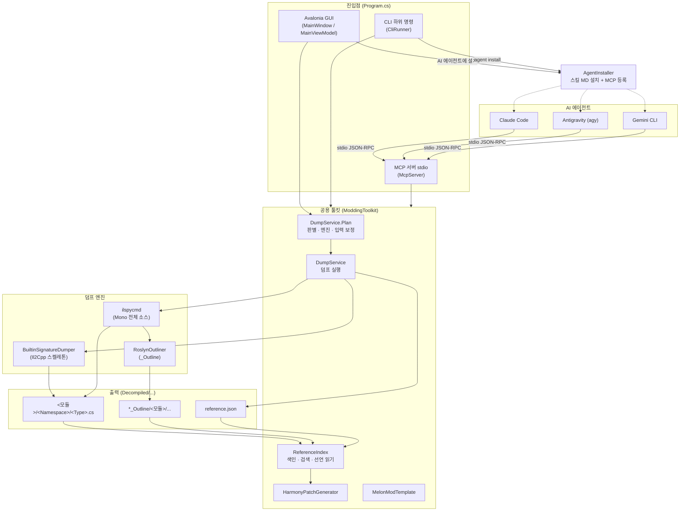
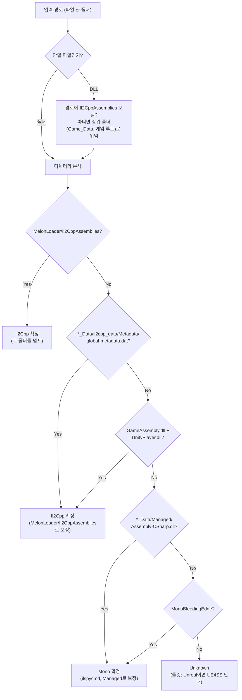
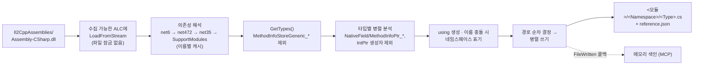
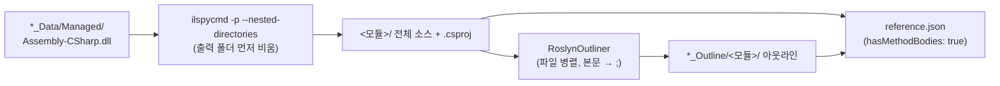
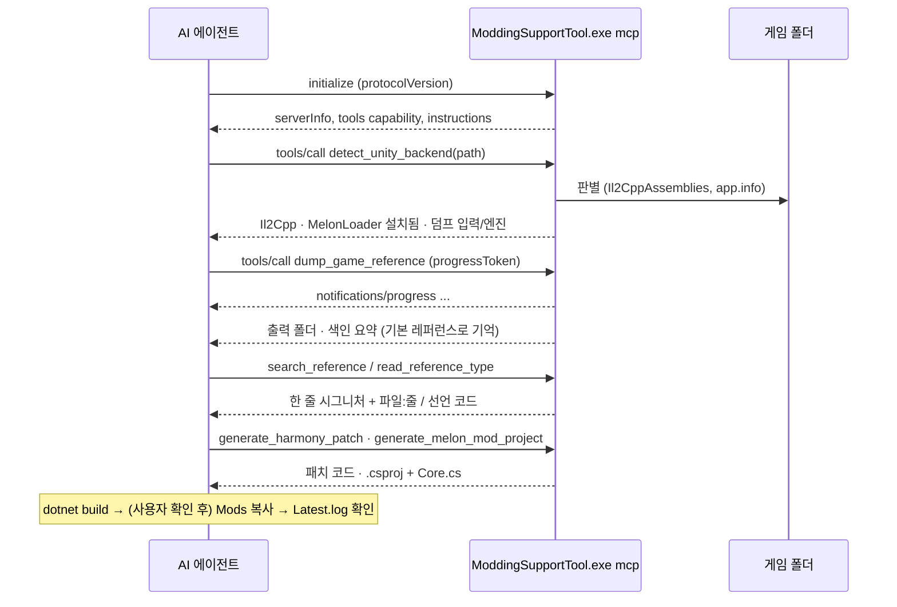
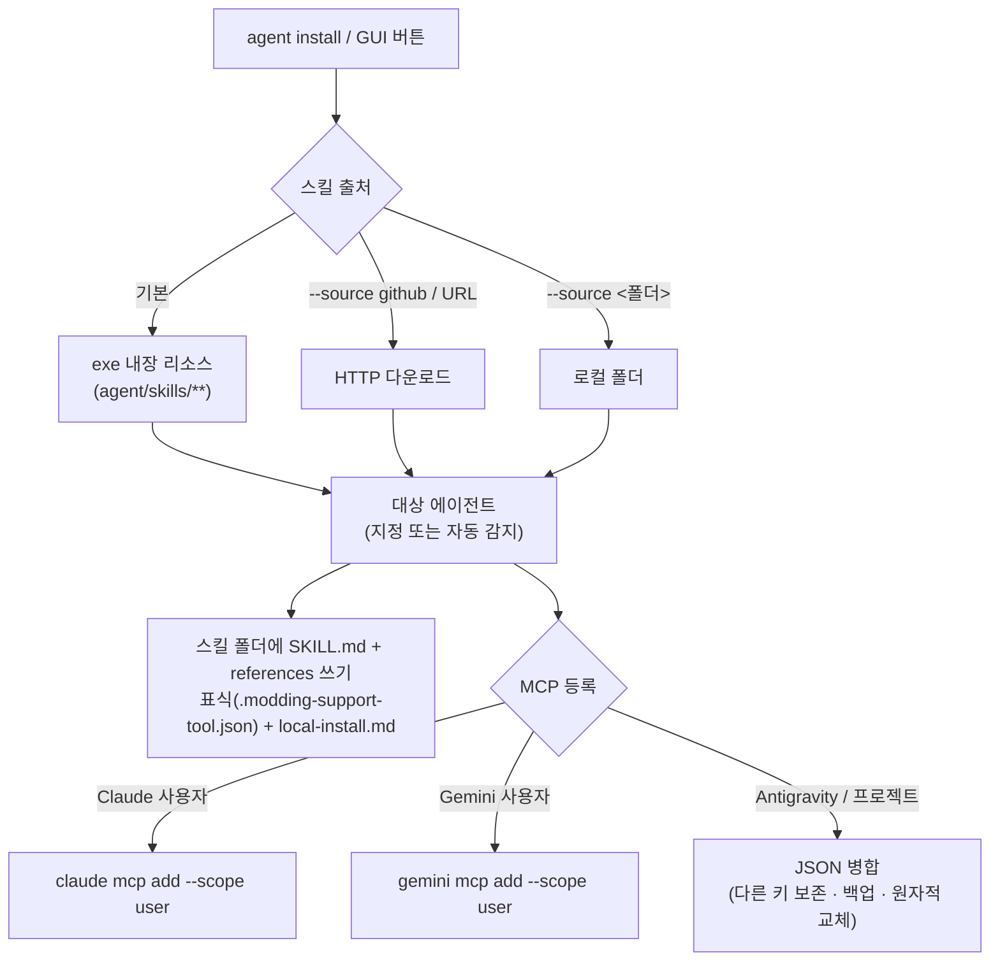

# 아키텍처 및 동작 파이프라인 (Architecture & Pipeline)

이 문서는 `Modding Support Tool`의 구조와 파이프라인을 다이어그램으로 설명합니다. 각 단계의 세부 규칙은 [core-logic.md](core-logic.md)에 있습니다.

> 범위: Unity(Mono/Il2Cpp) 게임에 **MelonLoader로 주입할 모드 DLL**을 만들 때 참고할 C# 레퍼런스를 만듭니다. Unreal Engine은 UE4SS, 네이티브 리버싱은 Ghidra/IDA 등 다른 도구를 쓰세요.

---

## 1. 전체 시스템 구조도

---

## 2. Unity 백엔드 판별 ([`UnityBackendDetector.cs`](../ModdingSupportTool/Core/Detection/UnityBackendDetector.cs))

- 게임 루트 스캔은 최대 깊이 8, **최대 4,000개 폴더**에서 멈추고 `CancellationToken`으로 취소할 수 있습니다.
- GUI는 경로 입력을 300ms 디바운스한 뒤 백그라운드에서 판별합니다.

---

## 3. Il2Cpp: 내장 SignatureDumper 파이프라인 ([`BuiltinSignatureDumper.cs`](../ModdingSupportTool/Core/BuiltinSignatureDumper.cs))

- Il2CppInterop 어셈블리는 모든 멤버를 `public`으로 노출하므로 원래 접근 제어자는 알 수 없습니다.
- 이름 충돌 판단은 덤프를 실행한 .NET 런타임의 기본 라이브러리 기준입니다. 그래서 앱(.NET 10)과 독립 SignatureDumper(.NET 8)의 표기가 드물게 다를 수 있습니다. (같은 런타임이면 출력이 같음)
- 덤프 전에 `<출력>/<모듈>` 폴더를 비워 게임 업데이트로 사라진 타입의 예전 파일이 남지 않게 합니다.

---

## 4. Mono: ilspycmd + AI 아웃라인

- ilspycmd 표준 출력/에러는 비동기로 로그에 흘려보내고, 취소하면 프로세스 트리 전체를 종료합니다.
- 인자는 `ProcessStartInfo.ArgumentList`로 넘겨 공백·따옴표가 든 경로도 안전합니다.

---

## 5. 에이전트 ↔ MCP 서버 흐름

---

## 6. 에이전트 설치 흐름 ([`AgentInstaller.cs`](../ModdingSupportTool/Agent/AgentInstaller.cs))

