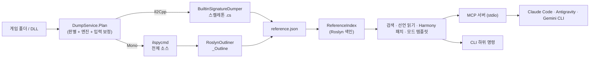

# 핵심 로직 (Core Logic)

이 문서는 Modding Support Tool이 **어떻게** 동작하는지, 각 단계의 규칙과 그렇게 만든 이유를 설명합니다.
사용법은 [usage.md](usage.md), 코드 예시는 [code-snippets.md](code-snippets.md)를 보세요.

> **범위**: 이 도구는 Unity(Mono/Il2Cpp) 게임에 **MelonLoader로 주입할 모드 DLL**을 만들 때 참고할 C# 레퍼런스를 만듭니다.
> Unreal Engine 게임은 **UE4SS**, Il2Cpp 메서드 본문·네이티브 바이너리 분석은 Cpp2IL / Il2CppDumper + Ghidra·IDA 같은 다른 도구의 영역입니다.

---

## 0. 한눈에 보기

모든 진입점(GUI, CLI, MCP)이 같은 구현을 씁니다.

| 계층 | 파일 | 역할 |
| :--- | :--- | :--- |
| 진입점 | `Program.cs` | 인자 없음 → GUI, `mcp` → MCP 서버, 그 밖 → CLI |
| 판별/계획 | `Core/Detection/*`, `Services/DumpService.Plan` | 백엔드 판별, 엔진 선택, 입력 폴더 보정, 게임 루트 찾기 |
| 덤프 | `Core/BuiltinSignatureDumper.cs`, `Services/DumpService.cs` | 스켈레톤/디컴파일, `reference.json` 기록 |
| 아웃라인 | `Core/RoslynOutliner.cs` | 메서드 본문 제거 |
| 레퍼런스 | `Core/Reference/*` | 색인·검색, Harmony 패치, 모드 템플릿 |
| 에이전트 | `Agent/*` | 공용 툴킷, MCP 서버, 스킬/MCP 설치기 |

---

## 1. 덤프 계획 (`DumpService.Plan`)

입력 경로 하나로 "무엇을, 어떤 엔진으로, 어느 폴더에서" 덤프할지 정합니다. CLI·GUI·MCP가 이 함수 하나를 써서 규칙이 어긋나지 않습니다.

1. 경로 정규화 (`Path.GetFullPath`) — `H:/game\Data`처럼 섞인 구분자를 정리
2. `UnityBackendDetector.Detect` — 백엔드와 추천 어셈블리 경로
3. 엔진 선택 — Mono면 `ilspycmd`, 그 외(Il2Cpp/미확정)는 `SignatureDumper`
4. 입력 보정 — 추천 경로가 존재하는 **폴더**면 입력을 그쪽으로 바꿈 (예: 게임 루트 → `MelonLoader/Il2CppAssemblies`, `*_Data/Managed`). DLL을 직접 고른 경우는 그 DLL을 유지
5. `GameLocator.Find` — 위로 올라가며 게임 루트(`*_Data`·`MelonLoader`·`UnityPlayer.dll`)를 찾고 `*_Data/app.info`에서 회사명·제품명을 읽음

### 백엔드 판별 규칙 (`UnityBackendDetector`)

| 순서 | 신호 | 결과 |
| :--- | :--- | :--- |
| 1 | 경로가 `MelonLoader/Il2CppAssemblies` 안 | Il2Cpp |
| 2 | `*_Data/il2cpp_data/Metadata/global-metadata.dat` | Il2Cpp |
| 3 | `GameAssembly.dll` + `UnityPlayer.dll` | Il2Cpp |
| 4 | `*_Data/Managed/Assembly-CSharp.dll` 등 | Mono |
| 5 | `MonoBleedingEdge` 런타임 + `Managed` | Mono |
| - | 없음 | Unknown (MCP/툴킷은 Unreal·Godot 흔적을 보고 UE4SS 등 안내) |

게임 루트에서 `*_Data`를 찾을 땐 최대 8단계 깊이, **최대 4,000개 폴더**까지만 돕니다(드라이브 루트를 넣어도 멈추지 않도록). `CancellationToken`을 받아서 GUI에서 새 입력이 오면 이전 탐색을 취소합니다.

---

## 2. 내장 SignatureDumper (`Core/BuiltinSignatureDumper.cs`)

Il2Cpp 게임은 MelonLoader가 만든 프록시 어셈블리(`Il2CppAssemblies`)만 관리 코드로 읽을 수 있고, 거기엔 **시그니처만 있고 본문이 없습니다.** 그래서 리플렉션으로 선언을 복원해 C# 스켈레톤을 만듭니다.

### 2.1 로드: 잠그지 않고, 한 번만

- .NET: 수집 가능한 `AssemblyLoadContext`에 `LoadFromStream`으로 올립니다. 파일 핸들을 쥐지 않으므로 덤프 중에도 DLL이 잠기지 않고, 끝나면 `Unload()`로 통째로 버립니다.
- 의존성은 `Resolving` 이벤트에서 `입력 폴더 → MelonLoader/net6 → net472 → net35 → Dependencies/SupportModules → MelonLoader` 순으로 찾습니다.
- **이름별 캐시**: 바이트/스트림으로 올린 어셈블리는 같은 의존성을 두 번 로드하면 타입 정체성이 갈라지므로, 한 번 해석한 이름은 캐시에서 돌려줍니다. 병렬 분석 중에도 해석 요청이 올 수 있어 `lock`으로 보호합니다.
- 타입을 하나도 못 읽으면 빈 결과를 "성공"으로 보고하지 않고 예외를 던집니다. (예: .NET Framework 빌드로 .NET 6 대상 Il2CppInterop 어셈블리를 읽으려 할 때 원인을 알려 줌)

### 2.2 Il2CppInterop 배관 멤버 생략

어셈블리가 `Il2CppInterop.Runtime`(구버전 `UnhollowerBaseLib`)을 참조하면 Il2CppInterop 프록시로 보고, 모드 작성에 쓰이지 않는 런타임 연결용 멤버를 기본으로 뺍니다.

| 생략 대상 | 이유 |
| :--- | :--- |
| `NativeFieldInfoPtr_*`, `NativeMethodInfoPtr_*` 정적 `IntPtr` 필드 | 네이티브 메타데이터 포인터. 모드 코드가 직접 쓰지 않음 |
| `(IntPtr pointer)` 생성자, 정적 생성자 | 프록시 객체 연결용 |
| `MethodInfoStoreGeneric_*` 중첩 타입 | 제네릭 메서드 포인터 저장소 |

Muse Dash 기준 **59,155개 멤버 생략, 출력 10.1MB → 4.3MB(-57%)**. `IncludeInteropMembers`(GUI 체크박스, CLI `--keep-interop`, MCP `include_interop_members`)로 되살릴 수 있습니다.

### 2.3 분석과 쓰기

1. 타입을 `Namespace → Name → FullName` 순으로 정렬
2. **타입별 분석을 병렬**로 실행 (`Parallel.For`, 결과는 정렬 순서대로 배열에 저장 → 출력이 실행마다 같음)
   - 종류(class/struct/interface/enum/delegate), 접근 제어자, `static/abstract/sealed`, 베이스·인터페이스
   - 필드(`const` 값은 C# 리터럴로), 프로퍼티(get/set 개별 접근자, `static`/`virtual`/`override`), 이벤트, 생성자, 메서드(`ref/out/params`, 기본값, 제네릭)
   - `virtual` vs `override`: `NewSlot` 플래그 + `GetBaseDefinition()`으로 구분
3. **using과 이름 충돌**: 파일에 실제로 나오는 타입만으로 `using`을 만들고, 현재 네임스페이스·using·전역 중 두 곳 이상에 같은 이름이 있으면 네임스페이스를 붙입니다. (예: `Il2CppSystem.Object` vs `UnityEngine.Object`)
4. **경로 결정은 순차, 쓰기는 병렬**: 대소문자만 다른 경로엔 `_2` 접미사를 붙이는데 이것이 순서에 의존하므로 경로는 먼저 순차로 정하고, 파일 쓰기만 병렬로 합니다.
5. 전역 타입은 `Global/` 폴더에 두되 **`namespace` 블록 없이** 씁니다. (가짜 `Global` 네임스페이스를 쓰면 모드 코드가 `using Global;`을 따라 쓰다 오류가 남)

### 2.4 리터럴 표기

| 값 | 출력 | 이유 |
| :--- | :--- | :--- |
| `float` | `1.5707964F` | 접미사가 없으면 C# 상수로 컴파일되지 않음. `"R"` 형식은 값을 정확히 되살림 |
| `double` | `"R"` 형식 | 런타임마다 다른 기본 표기 대신 왕복 가능한 표기 |
| `decimal` | `1.5M` | 접미사 필수 |
| `NaN`/무한대 | `float.NaN`, `double.PositiveInfinity` | 숫자 리터럴로 표현 불가 |
| 문자열/문자 | 따옴표 + 이스케이프 | `\n`, `\0`, 제어 문자 `\uXXXX` |

### 2.5 앱과 독립 프로젝트가 같은 소스를 쓰는 방법

`BuiltinSignatureDumper.cs`는 csproj에서 **컴파일 대상이면서 동시에 임베디드 리소스**(`Export/SignatureDumper.cs`)입니다. "SignatureDumper 소스 내보내기"는 이 리소스를 그대로 써서 `net472;net8.0` 프로젝트를 만듭니다. 그래서 이 파일은 net472에서도 컴파일되도록 최신 BCL 전용 API를 쓰지 않고, 로드 방식만 `#if NETFRAMEWORK`로 나눕니다(.NET Framework는 `AppDomain.AssemblyResolve` + `Assembly.Load(byte[])`).
검증: 같은 입력에서 앱 출력과 내보낸 net8.0 도구의 출력이 **파일 단위로 완전히 같습니다.**

---

## 3. Roslyn AI 아웃라인 (`Core/RoslynOutliner.cs`)

Mono 게임은 ilspycmd로 본문까지 디컴파일하므로 파일이 큽니다. 아웃라인은 **선언만 남겨** 에이전트가 적은 토큰으로 구조를 파악하게 합니다. 출력 형태는 SignatureDumper 스켈레톤과 같은 `선언;` 형식이라 에이전트가 두 형식을 똑같이 읽습니다.

| 원본 | 아웃라인 |
| :--- | :--- |
| `void Awake() { ... }` (여러 줄) | `void Awake();` |
| `public X() : base(1) { ... }` | `public X() : base(1);` |
| `public int Score => m_score + 10;` | `public int Score { get; }` |
| `get { return x; } set { x = value; }` (여러 줄) | `{ get; set; }` 한 줄 |
| 필드, 어트리뷰트, 문서 주석, `using` | 그대로 |

구현 규칙:

- `CSharpSyntaxRewriter`에서 메서드·생성자·소멸자·연산자 방문 시 **`base.VisitXxx`를 부르지 않습니다.** 어차피 버릴 본문 안까지 재작성하지 않아 빠르고, 본문 안 로컬 함수·람다도 함께 사라집니다.
- 본문 바로 앞 토큰(보통 `)`)의 줄바꿈을 지우고, 원래 선언 끝의 줄바꿈은 새 `;` 뒤로 옮겨 줄 구조를 유지합니다.
- 문서 주석을 구조로 파싱하지 않는 옵션(`DocumentationMode.None`)으로 파싱 비용을 줄입니다. 주석 텍스트는 그대로 보존됩니다.
- 파일 단위 **병렬 처리**(`Parallel.ForEachAsync`), 통계는 `Interlocked`로 합산합니다.
- 각 파일 맨 위에 `// [AI outline] ...` 한 줄을 붙여, 파일만 연 에이전트도 본문이 생략됐다는 걸 알게 합니다.

KALPA(1,177파일) 기준: **2.55초 → 0.77초**, 줄 108,465 → 40,398(62.8% 절감), 글자 3.2M → 1.0M(**68.9% 절감**, 토큰은 글자 수에 비례).

---

## 4. `reference.json`

덤프 출력 폴더 루트에 기록하는 매니페스트입니다. 모듈을 덤프할 때마다 같은 이름 모듈만 교체합니다.

- 게임 이름·루트·회사/제품명(`app.info`), 백엔드
- 모듈별 엔진, 원본 DLL, 상대 경로, 아웃라인 경로, 본문 포함 여부, 파일 수, 생략한 Il2CppInterop 멤버 수

에이전트(MCP/CLI)는 이 파일로 레퍼런스 종류를 추측 없이 알고, 색인 캐시의 갱신 기준(수정 시각)으로도 씁니다.

---

## 5. 레퍼런스 색인 (`Core/Reference/ReferenceIndex.cs`)

수천 개 `.cs`를 에이전트가 직접 grep/read 하면 토큰과 시간이 많이 듭니다. 그래서 선언만 메모리에 색인합니다.

- **루트 정규화**: `X_Outline`이나 모듈 폴더(`X/Assembly-CSharp`)를 넣어도 `reference.json`이 있는 덤프 루트를 찾습니다.
- **파싱 대상**: 아웃라인이 있으면 같은 상대 경로의 아웃라인을 파싱(작아서 빠름), 없으면 원본.
- **병렬 Roslyn 파싱** + `CSharpSyntaxWalker`. 타입은 재귀로 방문하고 멤버 노드에서는 내려가지 않습니다(본문 무시).
- 스켈레톤의 `// Nested in: Outer` 주석을 읽어 중첩 타입을 `Outer.Inner`로 복원 → `typeof(Outer.Inner)`에 그대로 쓸 수 있음
- 멤버 시그니처는 여러 줄 파라미터를 한 줄로 압축해 저장
- **캐시**: 루트별로 프로세스 안에 캐시하고, `reference.json` 수정 시각이 바뀌면 다시 만듭니다.
- **덤프 직후 메모리 색인**: 방금 쓴 수천 개 파일을 처음 열 때는 백신 실시간 검사 등으로 수 초가 걸립니다(측정: 같은 색인이 첫 읽기 4.0초, 이후 0.64초). 그래서 덤퍼·아웃라이너가 파일을 쓸 때 내용을 함께 넘기고(`FileWritten` 콜백), MCP 덤프는 그 내용으로 색인합니다 → **0.18초**.

### 검색 점수

| 일치 | 점수 |
| :--- | :--- |
| 대소문자까지 같음 | 100 |
| 대소문자 무시 같음 | 98 |
| `.질의`로 끝남 (`Type.Member`, 네임스페이스 생략) | 90 |
| 접두사 | 70 |
| 포함 (앞쪽일수록 높음) | 30~50 |
| 공백으로 나눈 단어 모두 포함 | 40 |
| `*`/`?` 와일드카드 | 60 |

- 타입은 같은 점수의 멤버보다 앞에, 컴파일러 생성 타입(`<>c`, `__c`, `_d__N`, `DisplayClass`)은 **-40점**으로 뒤로 보냅니다(지우지는 않음: 코루틴 `MoveNext` 패치에 필요할 수 있음).
- 결과는 `[종류] 전체이름 — 시그니처` + `상대경로:줄`로, 에이전트가 필요한 파일 위치만 받습니다.

### 선언 읽기

`read_reference_type`은 파일을 다시 파싱해 해당 타입 노드만 돌려줍니다. 기본은 아웃라인, `member`를 주면 그 멤버만 **전체 소스에서**(Mono는 본문 포함) 읽습니다. 들여쓰기는 걷어 내고 `max_chars`(기본 40,000자)로 자릅니다.

---

## 6. Harmony 패치 생성 (`HarmonyPatchGenerator`)

레퍼런스의 실제 선언으로 HarmonyX 패치 클래스를 만듭니다. 이름을 추측하지 않으므로 오타·오버로드 실수가 줄어듭니다.

| 상황 | 생성 규칙 |
| :--- | :--- |
| public 메서드 | `[HarmonyPatch(typeof(T), nameof(T.M))]` |
| 비공개 메서드 (Mono) | `nameof` 대신 `"M"` 문자열 |
| 오버로드 여러 개 | 오버로드마다 클래스 하나, `new Type[] { ... }`로 지정 |
| `ref`/`out`/`in` 인자 | 패치 인자는 `ref`, 오버로드 지정 시 `ArgumentType.Ref/Out` |
| 생성자 (`.ctor`) | `MethodType.Constructor`, 파라미터가 있으면 타입 배열 필수, Postfix |
| 프로퍼티 | getter → `MethodType.Getter` + `ref T __result`, setter → `MethodType.Setter` + `value` |
| static | `__instance` 없음 |
| 접근 불가 타입 | `[HarmonyPatch]` + `TargetMethod()` + `AccessTools.TypeByName("Ns.Outer+Inner")`, `__instance`는 `object` |
| 제네릭 메서드/타입 | 경고 주석 + `MakeGenericMethod` 안내 |
| `typeof(T?)` | 값 형식(`int?`)만 `?` 유지, 참조 형식 `string?`은 `?` 제거(컴파일 오류 방지) |

원본 파일의 `using`과 타입 네임스페이스를 함께 넣어, 생성 코드를 그대로 붙여도 이름이 해석됩니다.
Il2Cpp면 인라인·Transpiler 불가·`TryCast` 같은 주의점을, Mono면 `___필드` 주입 안내를 덧붙입니다.

---

## 7. MelonLoader 모드 템플릿 (`MelonModTemplate`)

게임 폴더를 보고 **실제로 있는 경로**로 `.csproj`를 만듭니다.

| | Il2Cpp | Mono |
| :--- | :--- | :--- |
| TargetFramework | `net6.0` | `MelonLoader/net472`에 MelonLoader.dll이 있으면 `net472`, 아니면 `net35` |
| 로더 | `MelonLoader/net6/{MelonLoader,0Harmony}.dll` | `MelonLoader/net472|net35/{MelonLoader,0Harmony}.dll` |
| 게임 참조 | `Il2CppAssemblies/{Il2Cpp*,UnityEngine*,Unity.*,Assembly-CSharp*}.dll` + Il2CppInterop | `*_Data/Managed/{UnityEngine*,Unity.*,Assembly-CSharp*}.dll` |

- 와일드카드 참조로 필요한 Unity 모듈을 빠짐없이 넣되, Mono의 `mscorlib`/`System*`/`netstandard`는 넣지 않아 중복 정의를 피합니다.
- 모든 참조는 `Private="false"`(게임에 이미 있는 DLL을 출력에 복사하지 않음).
- `MelonGame` 값은 `app.info`의 회사명·제품명. 다르면 MelonLoader가 모드를 로드하지 않습니다.
- `CopyToMods`는 기본 `false` — 게임 폴더를 건드리는 동작은 사용자가 켭니다.

검증: Muse Dash(Il2Cpp)와 KALPA(Mono)에서 템플릿 + 생성한 패치가 **경고·오류 0개로 빌드**되고, DLL에 패치 클래스와 `MelonGame` 어트리뷰트가 들어갑니다.

---

## 8. MCP 서버 (`Agent/Mcp/McpServer.cs`)

외부 SDK 없이 줄 단위 JSON-RPC 2.0(stdio)으로 구현했습니다.

- **프로토콜 협상**: 클라이언트가 요청한 버전이 지원 목록(`2025-11-25`, `2025-06-18`, `2025-03-26`, `2024-11-05`)에 있으면 그대로, 아니면 최신 버전으로 응답
- 메서드: `initialize`, `ping`, `tools/list`, `tools/call`, `notifications/cancelled`, 빈 `resources/list`·`prompts/list`
- **동시 처리**: 요청마다 Task로 처리해서 긴 덤프 중에도 `ping`/취소를 받습니다. 응답 쓰기는 `SemaphoreSlim`으로 직렬화
- **취소**: `notifications/cancelled`의 `requestId`로 해당 호출의 `CancellationTokenSource`를 취소
- **진행률**: `_meta.progressToken`이 있으면 덤프 로그를 `notifications/progress`로 보냄(300ms 간격 제한)
- **stdout 보호**: MCP 모드에선 콘솔을 붙이지 않고, `Console.Out`을 stderr로 돌려 프로토콜 외 출력이 섞이지 않게 합니다
- 도구 실행 오류는 JSON-RPC 오류가 아니라 `isError: true` 결과로, 알 수 없는 도구·필수 인자 누락은 `-32602`로 돌려줍니다

---

## 9. 에이전트 설치기 (`Agent/AgentInstaller.cs`)

| 에이전트 | 사용자 스킬 | 프로젝트 스킬 | MCP |
| :--- | :--- | :--- | :--- |
| Claude Code | `~/.claude/skills` | `.claude/skills` | 사용자: `claude mcp add --scope user` / 프로젝트: `.mcp.json` |
| Antigravity | `~/.gemini/config/skills` | `.agents/skills` | `~/.gemini/config/mcp_config.json` |
| Gemini CLI 등 | `~/.agents/skills` | `.agents/skills` | 사용자: `gemini mcp add --scope user` / 프로젝트: `.gemini/settings.json` |

- **스킬 출처**: 기본은 exe에 내장된 `agent/skills/**`(빌드 시 임베드). `--source github`(또는 URL)이면 같은 파일 목록을 HTTP로 내려받고, 폴더를 주면 그 폴더의 파일을 씁니다.
- **덮어쓰기 보호**: 설치한 스킬 폴더엔 `.modding-support-tool.json` 표식을 남깁니다. 같은 이름의 폴더가 있는데 표식이 없으면(사용자가 만든 스킬) `--force` 없이는 건드리지 않습니다. 표식이 있으면 지우고 다시 써서 예전 버전의 파일이 남지 않게 합니다.
- **설정 병합**: JSON 설정은 주석·끝 쉼표를 허용해 읽고, 다른 키는 그대로 둔 채 `mcpServers.modding-support-tool`만 바꿉니다. 처음 고칠 때 `*.mst-backup`을 남기고, 임시 파일에 쓴 뒤 교체해서 중간에 깨지지 않게 합니다.
- **공식 CLI 우선**: `~/.claude.json`은 Claude Code가 실행 중에도 쓰는 큰 상태 파일이라 직접 고치지 않고 `claude mcp add`로 등록합니다(같은 이름이 있으면 지우고 다시 등록 → exe 경로 갱신).
- `references/local-install.md`를 생성해 설치된 스킬이 exe 경로와 CLI 대체 명령을 알게 합니다.
- 공용 폴더(`.agents/skills`)는 한 번만 씁니다.

---

## 10. GUI 성능 (`ViewModels/MainViewModel.cs`)

| 병목 | 이전 | 이후 |
| :--- | :--- | :--- |
| 로그 출력 | 줄마다 `LogOutput += ...` → 전체 문자열 재생성(O(n²)) + 줄마다 UI 디스패치 | 아무 스레드에서 큐에 넣고, 100ms 타이머가 모아서 한 번 반영. 최근 200,000자만 유지 |
| 경로 입력 시 판별 | 키 입력마다 UI 스레드에서 최대 8단계 디렉터리 스캔 → 큰 폴더에서 창 멈춤 | 300ms 디바운스 → 백그라운드 실행 → 새 입력 시 취소, 탐색 4,000폴더 상한 |
| 덤프 시작 직후 | 판별 중이면 엔진이 이전 값일 수 있음 | 판별 작업을 기다린 뒤 시작 |
| 프리셋 버튼 | XAML에 하드코딩(코드와 이중 관리) | `PresetService.Presets`에서 생성, 없는 경로는 비활성화 |

---

## 11. 콘솔 처리 (`Program.cs`)

`WinExe`라 콘솔이 없습니다. 출력이 **파이프/파일로 리디렉션되지 않았을 때만** 부모 콘솔에 붙거나 새로 만듭니다. 에이전트가 파이프로 실행했는데 `AllocConsole`을 하면 출력이 새 창으로 가 버리기 때문입니다. `mcp` 모드는 아예 콘솔을 건드리지 않습니다.

---

## 12. 측정값 (Release, 같은 PC)

| 항목 | 이전 | 이후 |
| :--- | :--- | :--- |
| Il2Cpp 덤프 (Muse Dash, 2개 모듈) | 4.5초 | **2.9초** |
| Il2Cpp 출력 크기 | 10.1MB · 188,704줄 · 4,857파일 | **4.3MB · 112,809줄 · 4,716파일** |
| Mono 아웃라인 (KALPA 1,177파일) | 2.55초 · 줄 58.5% 절감 | **0.77초 · 줄 62.8% / 글자 68.9% 절감** |
| 덤프 직후 색인 | (파일 재읽기 시 4.0초) | **0.18초** (메모리) |
| 색인 후 검색 / 선언 읽기 | — | 3~40ms / 6~26ms |
| CLI `search` 1회 (새 프로세스, 색인 포함) | — | 약 0.85초 |
